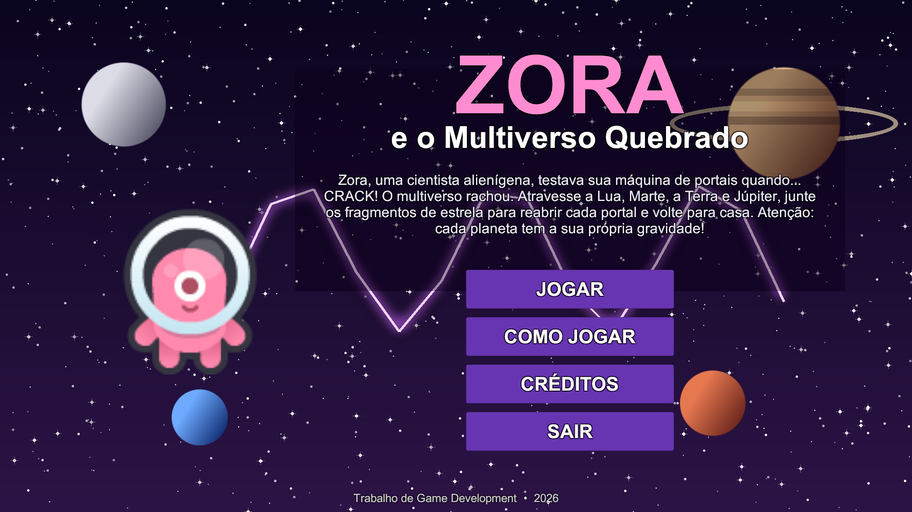
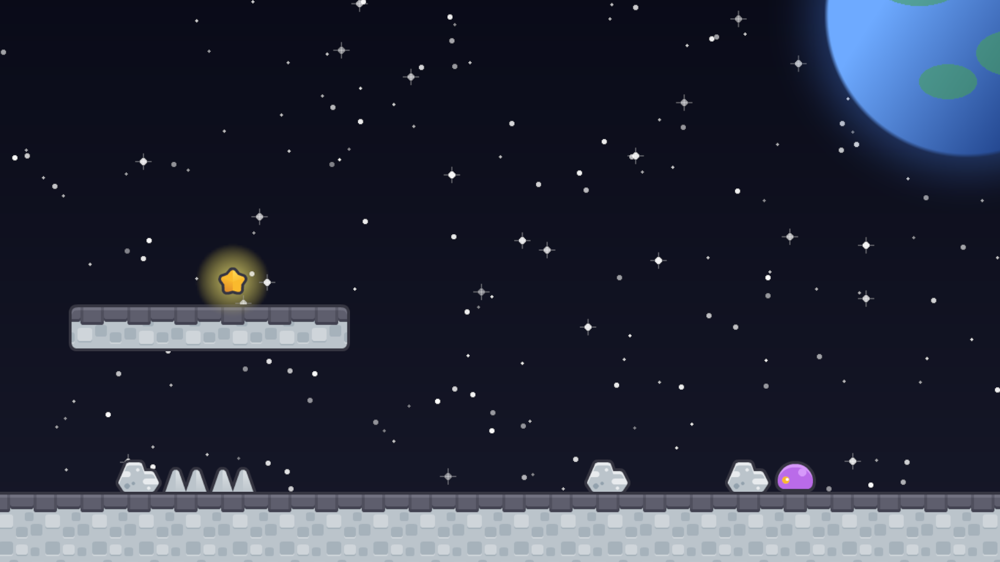
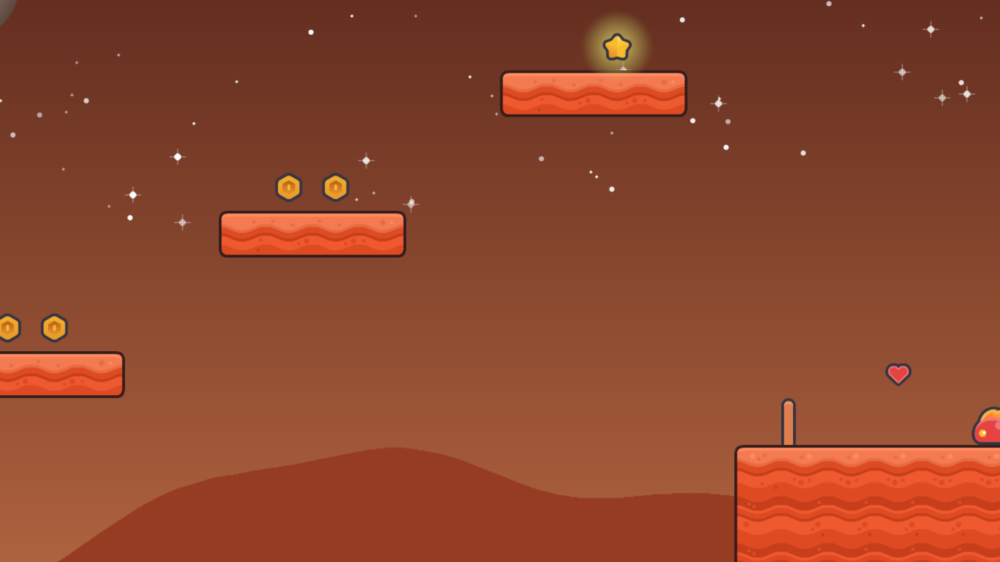
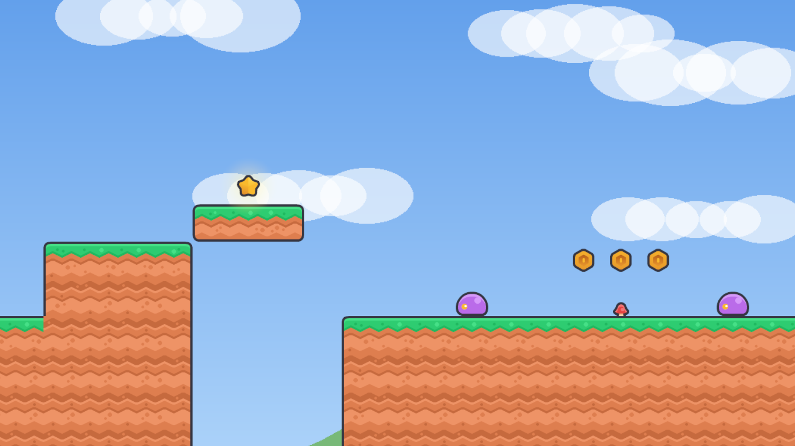
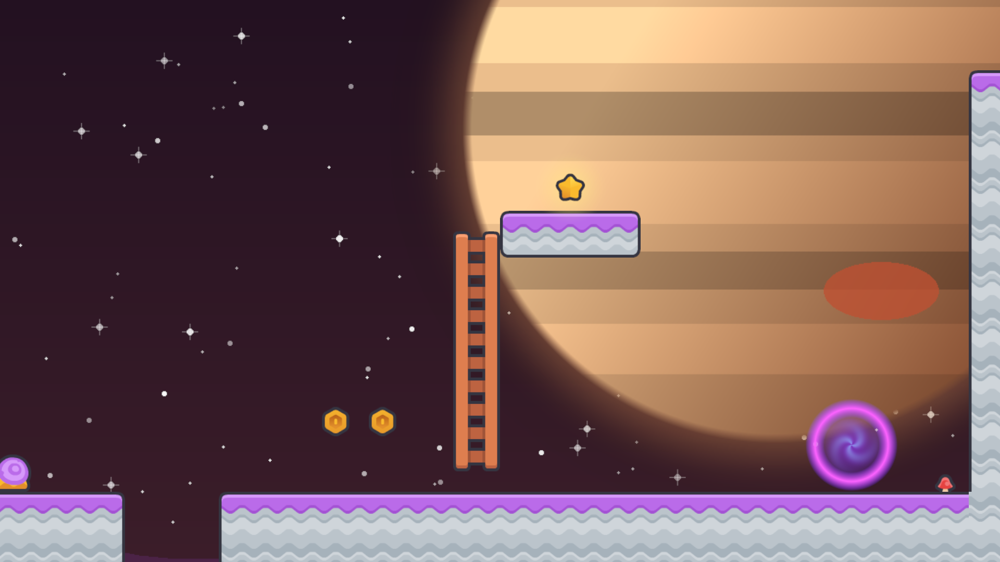
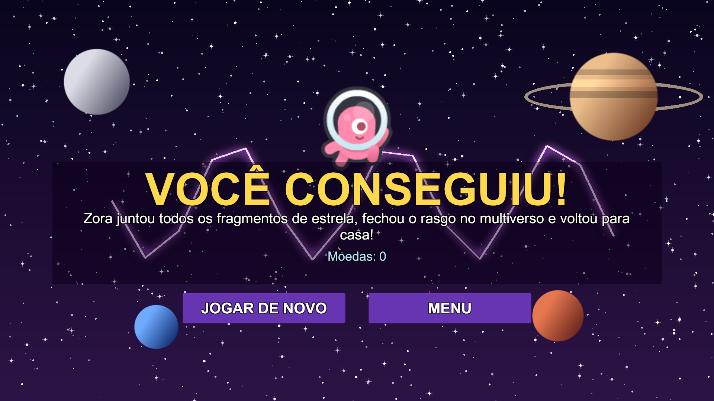
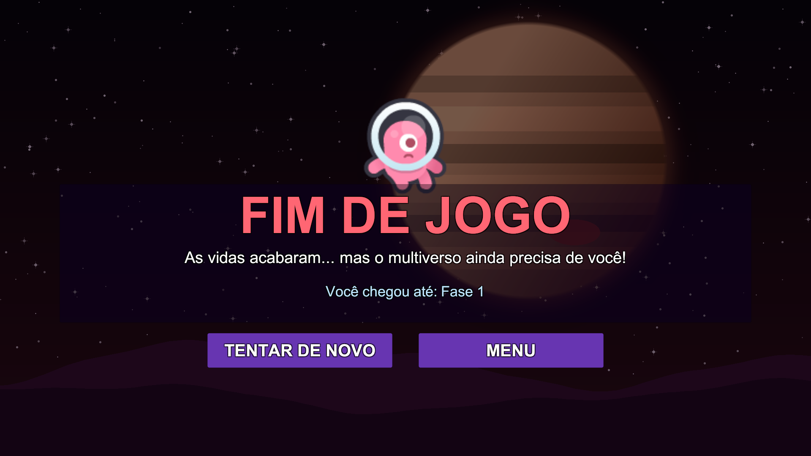

# 👽 Zora e o Multiverso Quebrado

Jogo de plataforma 2D feito na **Unity 6** com **C#** para a disciplina de **Game Development**.

> Zora, uma cientista alienígena, testava sua máquina de portais quando... **CRACK!** O multiverso rachou.
> Ela precisa atravessar a **Lua, Marte, a Terra e Júpiter**, juntar os **fragmentos de estrela** de cada planeta
> para reabrir os portais e voltar para casa. O detalhe: **cada planeta tem a sua própria gravidade.**



---

## 🪐 A ideia central: física de verdade

Cada fase usa a **gravidade real** do planeta, convertida para o jogo com uma **escala de raiz cúbica**:

```
gravidade_no_jogo = 30 × (g_planeta / 9,81) ^ (1/3)
```

Com a proporção direta, o pulo na Lua teria 18 blocos de altura e em Júpiter teria meio bloco, o que é impossível de jogar.
A raiz cúbica mantém a **ordem e a sensação** de cada planeta e deixa tudo jogável:

| Fase | Planeta | g real (m/s²) | g no jogo | Altura do pulo | Sensação |
|---|---|---|---|---|---|
| 1 | 🌕 Lua | 1,62 | 16,5 | ~5,1 blocos | pulos altos e lentos |
| 2 | 🔴 Marte | 3,71 | 21,7 | ~3,8 blocos | precisa de escadas |
| 3 | 🌍 Terra | 9,81 | 30,0 | ~2,8 blocos | pulo "normal" e preciso |
| 4 | 🪐 Júpiter | 24,79 | 40,9 | ~2,0 blocos | pesado: escalar e correr é essencial |

As alturas foram **medidas por um teste automático** (menu `Zora > 4 - Testar física das fases`).

---

## 🎮 Controles

| Tecla | Ação |
|---|---|
| **A / D** ou **← →** | andar |
| **Shift** (segurar) | correr |
| **Espaço** | pular (segurar = pulo mais alto) |
| **W / S** ou **↑ ↓** | subir / descer escadas |
| **Esc** ou **P** | pausar (no pause, **M** volta ao menu) |
| **F9** | pula para a próxima fase *(atalho de teste)* |

Também funciona com **controle** (analógico, A para pular, X/RT para correr).

---

## ⭐ Mecânicas

- **Movimento:** andar, correr, pular e escalar, cada um com sua animação.
- **Pulo responsivo:** *coyote time* (ainda dá para pular logo depois de sair da borda), *buffer* de pulo e pulo de altura variável.
- **Escadas:** a Zora sobe e desce, para no topo e sai andando para a borda.
- **Plataformas de mão única:** dá para atravessá-las pulando por baixo.
- **Fragmentos de estrela:** 3 por fase. O **portal do multiverso** só abre quando todos são coletados.
- **Inimigos:** slimes, caracol (andam e viram nas bordas) e abelhas (voam em onda). São derrotados **pulando em cima**.
- **Perigos:** espinhos e buracos.
- **Vidas e checkpoints:** 3 vidas (até 5 com corações), invencibilidade piscando após dano e bandeiras de checkpoint.
- **HUD:** vidas, moedas, fragmentos, nome do planeta com a gravidade e faixa de apresentação de cada planeta.
- **Feedback:** partículas, "pop" ao coletar, tremor de câmera, sons diferentes para cada ação e trilha sonora.
- **Telas:** Menu (Jogar, Como jogar, Créditos, Sair), Pausa, Vitória (com estatísticas) e Game Over (tentar a fase de novo).

---

## 🗺️ Fases

| | |
|---|---|
|  **Fase 1, Lua:** aprender a andar, pular e atravessar buracos |  **Fase 2, Marte:** escadas e plataformas em escadinha |
|  **Fase 3, Terra:** pulos precisos, abelhas e mais inimigos |  **Fase 4, Júpiter:** gravidade forte, escalar e correr |

| | |
|---|---|
|  |  |

As fases são desenhadas em **arquivos de texto** (`Assets/Fases/*.txt`), um caractere por bloco:

```
  #  terreno      =  plataforma     H  escada     ^  espinhos
  o  moeda        *  fragmento      +  coração    F  checkpoint
  S  slime        C  caracol        B  abelha     P  início     X  portal
```

---

## ▶️ Como executar

**Jogar (executável):**
1. Baixe e extraia o `.zip` do jogo.
2. Abra `ZoraMultiverso.exe`.

**Abrir o projeto na Unity:**
1. Unity **6000.6.9f1** ou mais nova, com o template 2D (URP).
2. Unity Hub → **Add** → selecione esta pasta.
3. Abra a cena `Assets/Scenes/Menu.unity` e aperte **Play**.

**Reconstruir tudo pelo menu `Zora`:**

| Menu | O que faz |
|---|---|
| `Zora > 1 - Construir jogo` | gera tiles, animações, prefabs e as 7 cenas a partir dos mapas |
| `Zora > 2 - Capturar prints` | salva imagens das fases em `Prints/` |
| `Zora > 3 - Gerar executável` | build Windows em `Build/Windows/` |
| `Zora > 4 - Testar física` | confere chão e altura do pulo em cada planeta |

---

## 🗂️ Estrutura do código

```
Assets/
├── Scripts/
│   ├── Nucleo/       EstadoJogo (vidas, moedas, cenas) · GerenciadorAudio
│   ├── Jogador/      MovimentoJogador · VidaJogador · AnimacaoJogador
│   ├── Fase/         ConfiguracaoPlaneta (gravidade) · Escada · Portal · Checkpoint
│   │                 Perigo · CameraSegue · ParallaxFundo
│   ├── Inimigos/     Inimigo (andante e voador)
│   ├── Coletaveis/   Coletavel (moeda, fragmento, coração)
│   ├── Efeitos/      Efeitos · Particula · RecursosEfeitos
│   ├── UI/           HUD · MenuPrincipal · TelaFinal · Flutuar
│   └── Editor/       ConstrutorJogo (monta as cenas) · ConfiguracaoSprites
├── Fases/            mapas das fases em texto
├── Art/              sprites (Kenney) e arte gerada (fundos, portal)
├── Audio/            efeitos (Kenney) e trilha sonora original
├── Gerado/           tiles e animações criados pelo construtor
├── Prefabs/          Zora, inimigos, coletáveis, portal...
└── Scenes/           Menu, Fase1_Lua ... Fase4_Jupiter, Vitoria, GameOver
Ferramentas/          scripts Python que geram fundos, trilha e mapas
Prints/               capturas de tela
```

---

## 🙏 Créditos

- **Desenvolvimento, design de fases e programação:** Bruna Coelho
- **Personagens, inimigos, cenário, itens e efeitos sonoros:** [Kenney, New Platformer Pack](https://kenney.nl/assets/new-platformer-pack), licença **CC0** (domínio público)
- **Fundos espaciais, portal e trilha sonora:** criados de forma procedural para este jogo (`Ferramentas/gerar_arte.py` e `Ferramentas/gerar_musica.py`)
- **Engine:** Unity 6 · **Linguagem:** C#
